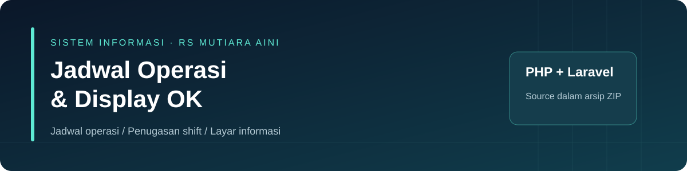
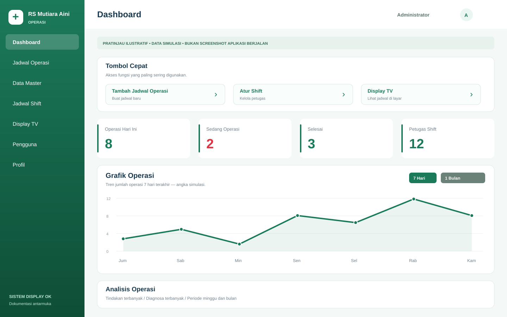
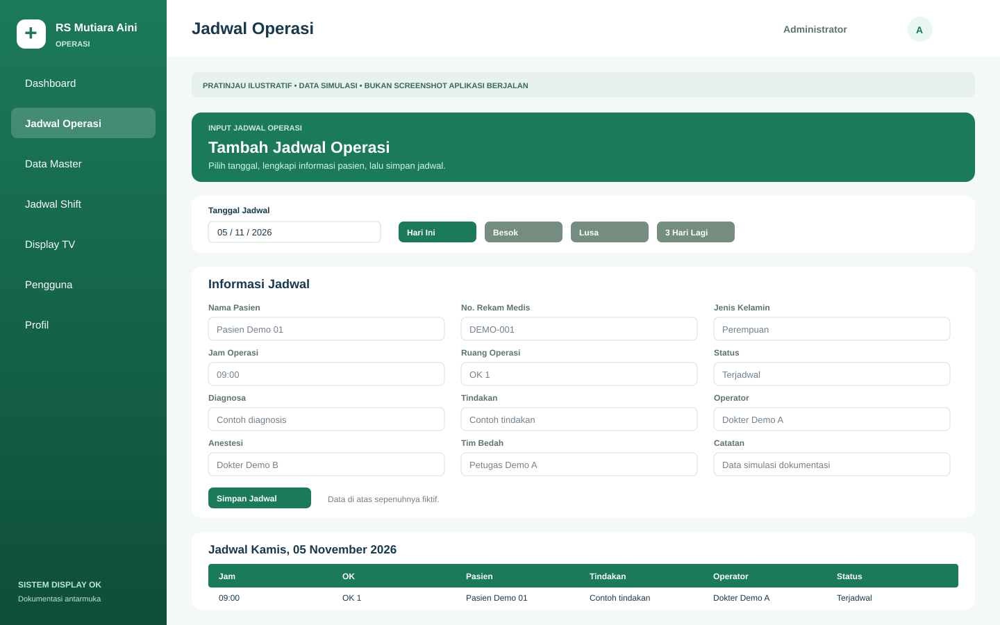
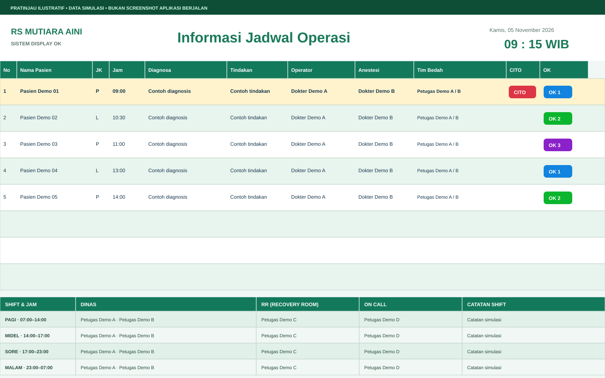

# Sistem Informasi Jadwal Operasi dan Display OK

Aplikasi web untuk mengelola jadwal operasi dan menampilkan informasi kamar operasi Rumah Sakit Mutiara Aini. Kode aplikasi Laravel ada di folder [`okrsma1/`](okrsma1/).

**[Pembaruan](#pembaruan-5-november-2026) · [Galeri UI/UX](#galeri-uiux) · [Instalasi](#instalasi-lokal) · [Upgrade](#upgrade-instalasi-yang-sudah-ada) · [Penggunaan](#penggunaan)**

## Pembaruan 5 November 2026

Kode aplikasi disinkronkan dari unggahan ZIP 5 November 2026. Perubahan utama mencakup:

- **Rekap Aktivitas IT** dengan pencatatan perubahan jadwal, data master, shift, pengguna, serta operasi backup. Detail log dapat menampilkan nilai sebelum dan sesudah perubahan.
- **Backup dan restore MySQL** dari panel admin. Pengguna berwenang dapat membuat, mengunduh, memulihkan, dan menghapus cadangan SQL.
- **Pelacakan pembuat dan pengubah jadwal operasi**, dengan migrasi untuk tabel log dan kolom pelacakan pada jadwal.
- **Penyegaran antarmuka** pada dashboard, formulir jadwal, login, dan Display TV.

## Galeri UI/UX

Galeri berisi ilustrasi antarmuka dengan data simulasi. Tampilan aktual dapat berbeda, terutama pada halaman yang diperbarui.

### Dashboard admin

Ringkasan aktivitas, tombol cepat, dan area grafik untuk membantu admin menemukan informasi utama.



Sumber tampilan: [dashboard Blade](okrsma1/resources/views/admin/dashboard.blade.php) dan [layout admin](okrsma1/resources/views/layouts/admin.blade.php).

### Input dan daftar jadwal operasi

Pemilihan tanggal, informasi pasien dan tindakan, ruang operasi, tim, serta daftar jadwal pada tanggal terpilih.



Sumber tampilan: [halaman jadwal](okrsma1/resources/views/admin/schedules/index.blade.php) dan [field formulir](okrsma1/resources/views/admin/schedules/_form_fields.blade.php).

### Display TV

Layar informasi jadwal dengan penanda ruang OK, CITO, jam, serta susunan petugas Dinas, RR, dan On Call.



Sumber tampilan: [display Blade](okrsma1/resources/views/display/index.blade.php).

| Area | Fokus antarmuka |
| --- | --- |
| Navigasi admin | Sidebar hijau dan pengelompokan menu |
| Dashboard | Tombol cepat, ringkasan angka, dan grafik |
| Jadwal | Pemilihan tanggal dan pengelompokan field |
| Display TV | Tabel informasi, warna ruang OK, dan petugas shift |

## Status saat ini

Branch utama berisi kode aplikasi dan aset dokumentasi. Konfigurasi lokal, dependensi terpasang, cadangan database, log, sesi, cache, dan foto unggahan dikelola di masing-masing lingkungan. Template [`.env.example`](okrsma1/.env.example) menyediakan pengaturan awal dengan `APP_KEY` kosong. Seeder lokal hanya membuat akun admin awal.

## Fitur yang ada di source

- Login/logout dengan username dan password; pembatasan akses admin berdasarkan permission.
- Dashboard serta tambah, ubah, hapus, salin antar tanggal, dan pindahkan waktu jadwal operasi.
- Jadwal memuat pasien, tanggal/jam, OK 1–3, diagnosis, tindakan, operator, anestesi, tim bedah, CITO, catatan, dan status Terjadwal/Selesai/Batal.
- Data master pasien, operator, anestesi, tim bedah, dan profesi.
- Pengelolaan shift dan penugasan petugas Dinas, RR, dan On Call; penyalinan penugasan antar tanggal.
- Cetak jadwal operasi dan ekspor jadwal operasi berformat XML Spreadsheet dengan ekstensi `.xls`.
- Display jadwal dan shift melalui `/display`, dengan pengambilan data setiap 3 detik dari `/display/events`.
- Pengelolaan pengguna/permission, profil dan foto pengguna, serta pesan sapaan.

Ekspor shift masih perlu diperbaiki. Route memanggil `export`, sedangkan `ShiftController` menyediakan `exportCsv`.

## Struktur aplikasi

Direktori [`okrsma1/`](okrsma1/) berisi:

| Lokasi | Isi |
| --- | --- |
| `app/Http/Controllers/` | Logika autentikasi, jadwal, shift, display, dan administrasi |
| `app/Models/` | Model data aplikasi |
| `app/Services/DatabaseBackupService.php` | Pembuatan dan pemulihan cadangan MySQL |
| `routes/web.php` | Route halaman dan endpoint data |
| `resources/views/` | Tampilan Blade admin, login, dan display |
| `database/migrations/` | Definisi dan perubahan skema database |
| `database/seeders/DatabaseSeeder.php` | Akun admin awal (tanpa data pasien/staf) |
| `composer.json`, `composer.lock` | Dependensi PHP |
| `public/` | Entry point web dan aset publik |

## Kebutuhan instalasi

- PHP 8.2 atau lebih baru yang kompatibel dengan lockfile, Composer, Git, dan ekstensi PHP yang diminta dependensi.
- MySQL dan ekstensi PHP PDO MySQL. Modul backup dan restore menggunakan perintah SQL khusus MySQL.
- Hak tulis untuk `storage/`, `bootstrap/cache/`, serta `public/uploads/profiles/` jika menggunakan unggahan foto.
- Browser dan koneksi ke CDN yang dipakai antarmuka admin.

## Instalasi lokal

1. Ambil kode dan buat konfigurasi lokal.

   ```bash
   git clone https://github.com/atnanbuyung00-prog/Sistem-display-ok.v1.git
   cd Sistem-display-ok.v1/okrsma1
   cp .env.example .env
   ```

2. Buat database MySQL kosong dan akun lokal yang memiliki izin pada database tersebut. Atur `DB_DATABASE`, `DB_USERNAME`, dan `DB_PASSWORD` di `.env`, lalu jalankan:

   ```bash
   composer install
   php artisan key:generate
   php artisan migrate
   ```

3. Untuk percobaan lokal dengan database baru, jalankan `php artisan db:seed`. Seeder membuat akun `admin` dengan password awal `admin`. Ganti password sebelum memberikan akses kepada pihak lain.

## Upgrade instalasi yang sudah ada

1. Cadangkan database dan simpan salinan konfigurasi `.env` di tempat terbatas.
2. Perbarui kode aplikasi. Gunakan kembali `.env` dan `APP_KEY` instalasi yang sudah ada untuk upgrade rutin.
3. Dari direktori `okrsma1/`, jalankan:

   ```bash
   composer install --no-dev --optimize-autoloader
   php artisan optimize:clear
   php artisan migrate --force
   ```

   Migrasi baru membuat tabel `activity_logs` dan menambahkan kolom pembuat serta pengubah pada `surgery_schedules`. Terapkan migrasi sebelum membuka akses ke versi baru.

4. Periksa login, jadwal, Display TV, Rekap Aktivitas IT, dan daftar backup di lingkungan uji.

## Menjalankan

Dari direktori `okrsma1/`:

```bash
php artisan serve --host=127.0.0.1 --port=8000
```

Buka:

| URL lokal | Kegunaan |
| --- | --- |
| `http://127.0.0.1:8000/login` | Login admin |
| `http://127.0.0.1:8000/admin` | Dashboard sesuai permission |
| `http://127.0.0.1:8000/display` | Layar jadwal dan shift |
| `http://127.0.0.1:8000/display?date=2026-11-05` | Contoh display untuk tanggal tertentu |
| `http://127.0.0.1:8000/admin/activity-logs` | Rekap Aktivitas IT |
| `http://127.0.0.1:8000/admin/backups` | Backup dan restore database |

Server bawaan ini untuk pengembangan lokal. Pada web server, arahkan document root ke `public/`.

## Penggunaan

1. Login dengan akun yang sudah dibuat. Akun awal di atas tersedia hanya setelah seeder dijalankan.
2. Lengkapi master operator, anestesi, profesi, dan tim bedah sesuai kebutuhan.
3. Masukkan jadwal operasi: pilih tanggal, isi pasien, jam, ruang OK, tindakan, serta tenaga yang bertugas. Gunakan pengelolaan jadwal untuk mengubah, menghapus, atau menyalin data.
4. Atur shift dan petugas untuk tanggal yang dipilih.
5. Buka `/display` pada browser layar informasi; tanggal bawaan menggunakan Asia/Jakarta. Tinjau perubahan setelah data disimpan.
6. Gunakan halaman jadwal untuk cetak atau ekspor operasi. Ekspor shift masih memiliki batasan yang disebutkan di atas.

## Akses log aktivitas dan cadangan

- Halaman log memerlukan `audit.view` dan halaman backup memerlukan `backup.manage`. Pada versi ini, `user.manage` juga memberikan kedua akses tersebut.
- Cadangan disimpan di `storage/app/backups/`. Batasi akses ke cadangan dan detail log karena keduanya dapat berisi data pasien. Gunakan hanya file SQL dari sumber tepercaya. Uji restore pada database terpisah karena proses ini dapat menimpa tabel aktif.
- Route `/display` dan `/display/events` dapat diakses tanpa login. Batasi aksesnya ke jaringan yang berwenang sebelum menampilkan data pasien.

## Verifikasi

Impor kode, pemeriksaan konfigurasi contoh, dan pemeriksaan perubahan Git telah dilakukan. Jalankan pengujian migrasi, alur aplikasi, dan restore pada lingkungan uji sebelum memakai versi ini di produksi.
